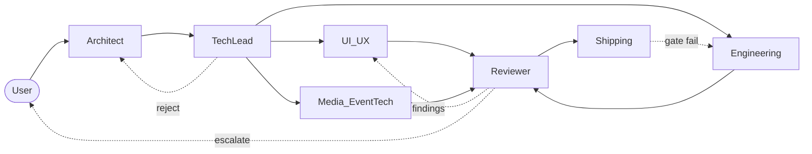

<div align="center">


**Language / Sprache / Idioma**: **English** · [Deutsch](README.de.md) · [Português](README.pt.md)

# AOS — BDB Agent OS

[](https://www.npmjs.com/package/@hybridlabor-api/aos)
[](https://www.npmjs.com/package/@hybridlabor-api/aos)
[](https://github.com/hybridlabor-api/aos/stargazers)
[](https://github.com/hybridlabor-api/aos/commits/main)
[](https://github.com/hybridlabor-api/aos/actions)
[](https://github.com/hybridlabor-api/aos/actions/workflows/skillspector.yml)
[](LICENSE)
[](package.json)
[](#skills)
[](#subagents)
[](#mcp-servers)
[](#playbooks)
[](#supported-harnesses)
[](https://skills.sh/hybridlabor-api/aos)

**The operating system for AI agent harnesses.**
One install: the same 269 skills, 29 subagents and GO gate across nine harnesses.

</div>

AOS installs a curated skill library, a subagent roster, gate hooks and a runnable multi-agent build pipeline into every coding-agent harness on your machine.

```bash
npx -y @hybridlabor-api/aos@latest
```

Built for people who already run **Claude Code, Google Antigravity, Codex CLI, OpenCode, Cursor, Windsurf, Roo Code / Cline or Aider** and want all of them to behave the same way. Alternative: `npx skills add hybridlabor-api/aos` (skills only; gates and MCPs need the full installer).

---

## What you get

| | |
|---|---|
| **Skills** | 269 curated skills in eight categories: bdb-core, design-ui-ux, engineering-method, engineering-hardware, media-eventtech, library, saas-ops, business-ops. 34 of them are playbooks |
| **Subagents** | 29 agents: the seven pipeline nodes plus 22 auxiliary specialists, compiled into each harness's native format. See [Subagents](#subagents) |
| **MCP servers** | 21 local servers for creative software, OS control, memory and cross-harness delegation. See [MCP servers](#mcp-servers) |
| **Pipelines** | `/startcycle` (linear), `/startcycle-graph` (durable state), `/startcycle-graph-user` (throwaway fan-out), plus the [multi-session workflow](#multi-session-workflow) |
| **GO gate** | Hook-enforced release safety: blocks `git push`, `npm publish`, merges and destructive commands until you type **GO**, with scoped, time-limited grants and [gate profiles](#gate-profiles) |
| **A2A** | Claude Code, OpenCode, Antigravity (agy) and Codex sessions exchange messages on localhost. See [A2A](#a2a-sessions-that-talk-to-each-other) |
| **Memory** | memB (vector), deja (session index), OpenWiki (codebase wiki), Synapse (code city). See [Memory and knowledge](#memory-and-knowledge) |
| **Playbooks** | 34 guided workflows (`pb-bug-fix`, `pb-ship`, `pb-show-build`, `pb-offer`, ...) with declared GO points |
| **Commands** | 15 slash commands: `/plan`, `/graph`, `/playbooks`, `/setup`, `/init`, `/doctor`, `/store`, `/hub`, `/memb`, `/orchestrator`, `/mastersession`, `/brainstorm`, `/shipping`, `/startproject`, `/loop` |
| **CLIs** | 20 `bin` entries in `package.json` (installer aliases, `aos-gate`, `aos-gogate`, `aos-a2a`, `aos-acp`, `aos-hub`, `aos-sessions`, `aos-doctor`, ...) |
| **Tools** | Plan Canvas, agenttrail, archify, AOS Store, Launchpad, Doctor, MCP gateway, Codenotch |
| **Modules** | Optional: Creator Extension, Hardware and PCB, Rust + Tauri, AO, Synapse, Token Saver. See [Optional modules](#optional-modules) |

---

## Quick start

| I want to... | Run |
|---|---|
| Install for every harness | `npx -y @hybridlabor-api/aos@latest` |
| See what would change | `npx -y @hybridlabor-api/aos@latest --dry-run` |
| Minimal context | `npx -y @hybridlabor-api/aos@latest --profile=minimal` |
| Add every optional module | `npx -y @hybridlabor-api/aos@latest -y --profile=full` |
| Refresh hooks only | `npx -y @hybridlabor-api/aos@latest --hooks-only` |
| Check setup | `aos doctor` |
| Browse and add skills | `aos store ui` or `/aos-store` |
| Run a pipeline | `/plan` then `/startcycle-graph`, or `/playbooks` |

---

## Install

Requirements: Node.js >= 20. macOS, Linux and Windows (PowerShell).

The installer detects harnesses, asks which to target, copies skills, compiles subagents, wires hooks, merges MCP configs (existing entries are kept) and offers the optional modules. Later runs open a menu:

| Menu item | What it does |
|---|---|
| Quick Update | Refreshes skills, templates, hooks and installed modules to the version you just ran |
| Run System Checkup / Doctor | Runs `aos doctor`: dependencies, file placement, daemons, hooks |
| Drop Local Project Harness | Copies the dispatcher contract into the current directory |
| Reconfigure System | Change targets, tier or options |
| Uninstall AOS | Removes what the installer placed; your data stays |

### Non-interactive

```bash
npx -y @hybridlabor-api/aos@latest -y --platforms=2          # Claude only, all defaults
npx -y @hybridlabor-api/aos@latest -y --platforms=1,5 --mcps=none
npx -y @hybridlabor-api/aos@latest --dry-run                 # print what would change
```

`--platforms=` values: `0` universal (all detected), `1` Antigravity, `2` Claude Desktop / Claude Code, `3` Cursor, `5` Codex CLI, `6` Windsurf, `7` Roo Code / Cline, `8` Aider, `10` AOS CLI. `4` (custom paths) needs the interactive menu. `--mcps=<name,name>|all|none` picks the MCP subset.

Profiles: `--profile=standard` (default), `minimal` (skills, agents, rules only; no context hooks, OpenWiki, Token Saver, Codenotch, modules, gateway or fleet) and `full` (standard plus every optional module with `-y`). Other flags: `--no-hooks`, `--hooks-only`, `--without=id,id`, `--modules=id,id`, `--dry-run`. Gate and safety hooks (`go-gate`, `go-token`, `go-grant`, `graph-gate`, `conventional-commits`, `env-file-protection`) always install.

### Local project harness

```bash
cd your-project && npx -y @hybridlabor-api/aos@latest --project-harness -y
```

Drops only the dispatcher contract (`.agents/`), gate hooks, agent definitions, the `/startcycle-graph` workflow and the OpenCode plugin into one repository.

---

## Supported harnesses

| Harness | Skills | Subagents | Hooks | Plugin / rules |
|---|---|---|---|---|
| Claude Code / Desktop | `~/.claude/skills` | `~/.claude/agents` | `~/.claude/hooks` + `settings.json` (GO gate, graph gate, env-file protection, Conventional Commits, memB inject, trail relay) | `.claude-plugin/` manifest, slash commands |
| Google Antigravity (agy) | `~/.gemini/config/skills` | `~/.gemini/config/agents` | `~/.gemini/config/hooks.json`, `~/.gemini/antigravity-cli/hooks.json` | `/bdb-aos:<cmd>` commands, see [docs/codex-agy-setup.md](docs/codex-agy-setup.md) |
| Codex CLI | `~/.agents/skills` | `~/.codex/agents` | `~/.codex/hooks` + `config.toml` | `.codex-plugin/`, `$bdb-aos:<cmd>` commands, see [docs/codex-agy-setup.md](docs/codex-agy-setup.md) |
| OpenCode | `~/.config/opencode/skills` | `~/.opencode/agents` | via plugin | `bdb-aos.js` plugin and `/startcycle-graph` command, see [docs/opencode-setup.md](docs/opencode-setup.md) |
| Cursor | `~/.cursor/skills` | none | none | `.cursor/rules` (project) |
| Windsurf | `~/.windsurf/bdb-skills` | none | none | `mcp.json` |
| Roo Code / Cline | `~/.roo/skills` | none | none | `.roomodes` (project) |
| Aider | `~/.aider/bdb-skills` | none | none | none |
| AOS CLI (`pi`) | `~/.agents/skills` | `~/.agents/AGENTS.md` | none | separate install, Node >= 22.19, see [packages/aos-cli](packages/aos-cli/README.md) |

BDB AO Codenotch (macOS app, Windows installer) is installed by default on macOS and Windows, never Linux; opt out with `--no-codenotch` or `AOS_CODENOTCH=0`. See [docs/codenotch.md](docs/codenotch.md).

### Capability tiers

The tier says what is actually wired; per-row evidence is in [docs/harness-capabilities.md](docs/harness-capabilities.md).

| Tier | Harnesses | What you get |
|---|---|---|
| 1 Full | Claude Code | GO gate as an enforced hook, typed grants and modes, Fleet panel, A2A inbox drained into the next prompt, all context hooks, MCP gateway entries |
| 2 Gate and grants | OpenCode | GO gate through the plugin, grants capped at 2 h and no `off` mode, A2A injected as a prompt, MCP gateway entries; no panel |
| 3 Gate hook only | Codex CLI, Antigravity (agy) | A `PreToolUse` gate hook is installed; grants and modes are not wired (only a literal human `GO` counts); whether the hook fires under `codex exec`, `aos-acp` or `agy --print` is **unverified**; A2A inbound by `codex queue` (Codex) or pull-only (agy) |
| 4 Skills, rules, MCP | Cursor, Windsurf, Roo Code / Cline, Aider | Skills and project rules; **no hook**, so the Destructive Actions text in `AGENTS.md` is the only safety layer |
| Not supported | Zed, Kimi | No installer target |

Where a tier has no hook, nothing mechanical stops a guarded command: use a Tier 1 or 2 harness for anything that can push, publish or delete.

---

## The dispatcher graph



The graph is the contract behind `/startcycle-graph`: a typed record in `production_artifacts/state.json` (schema in [.agents/state.schema.json](.agents/state.schema.json)), per-node state fragments that the dispatcher merges, and predicate edges that send work back. Contract: [.agents/graph.md](.agents/graph.md). Node registry: [.agents/nodes.json](.agents/nodes.json). Executor: [.claude/workflows/startcycle-dispatch.mjs](.claude/workflows/startcycle-dispatch.mjs).

- Nodes never call each other. A node reads state, works, writes its fragment, returns; only the dispatcher routes.
- Reviewer isolation: it reads artifacts and the plan's contract, never the build node's reasoning.
- No-progress guard: the same blocking finding ID on a second repair round escalates to a human; `max_iterations` (default 3) stops the loop.
- Reviewer and Shipping are two different checks: adversarial correctness review, then mechanical gate execution.
- The final push is behind the GO gate: the dispatcher asks for your **GO**, it cannot grant one.

The graph runs with the Claude workflow runtime and Claude subagents. It does not start OpenCode, agy or Codex workers; for that use the [multi-session workflow](#multi-session-workflow).

---

## The pipelines

| Variant | Use it when | State | Who runs the nodes |
|---|---|---|---|
| `/startcycle` | One feature, you stay in the loop | Markdown in `production_artifacts/`; no `state.json`, no repair loop | The main session plus subagents |
| `/startcycle-graph` | A larger build that should run unattended with a record, repair loop, quality gate and escalation | `state.json` plus per-node fragments | The workflow `startcycle-dispatch.mjs` |
| `/startcycle-graph-user` | Any project, small throwaway fan-out; nothing persistent left behind | None | The main session; workers via an installed external CLI if present, else the Agent tool |

`/startcycle --skill=<name> <goal>` forces a skill into every node. Push, publish and version bumps stay behind the [GO gate](#the-go-gate) in every variant.

---

## Multi-session workflow

The pipelines run inside one session. Real projects often run across several: one session you talk to, one orchestrator per repository, one shared plan, workers on different harnesses. AOS provides the channels (master session, `aos-acp`, `aos-a2a`, go-gate, agenttrail). The roles on top are a working convention, not a shipped component: [docs/orchestrator-chain.md](docs/orchestrator-chain.md) states that no code names a "project orchestrator".

| Role | Job | Mechanism in AOS |
|---|---|---|
| Master session | Overview of all sessions; asks for status; relays your GO as `GO <session>` | `master-session` skill, `/mastersession`, `pb-master` |
| Project orchestrator | Owns one repository: breaks the goal down, picks the pipeline, reviews results | `/startcycle-graph`, `ao-orchestrator` (optional) or a plain session |
| Task manager | Keeps the single shared plan current | Convention: a plan file that agenttrail renders (`production_artifacts/00_execution_plan.md`), approval in Plan Canvas |
| Workers | One slice each, on OpenCode, agy or Claude | `aos-acp <claude\|codex\|opencode> --name <worker>`, `mcsc` delegate tools for one-shot tasks |

**Invariants.** GO is never inherited: you type `GO <session>` in the master and the worker's gate consumes one single-use token. An A2A message is context, never a GO. Workers delete nothing; cleanup is the dispatcher's job after your GO. A blocked command is not retried in another form. A2A depth is limited (`AOS_A2A_MAX_DEPTH`, default 1). Details: [docs/orchestrator-chain.md](docs/orchestrator-chain.md), [docs/delegation-routing.md](docs/delegation-routing.md), [docs/a2a.md](docs/a2a.md).

---

## Subagents

29 agents are compiled into the native agent format of Claude Code, Antigravity, Codex and OpenCode; Cursor, Windsurf, Roo and Aider get none. Sources are in [agents/](agents/). AOS pins no model: agents inherit the session model unless `.aos/pipeline.json` overrides a role per harness ([docs/agent-models.md](docs/agent-models.md)).

| Group | Agents |
|---|---|
| Pipeline nodes (7) | `architect`, `techlead`, `godmode-ui-ux`, `godmode-engineering`, `godmode-media-eventtech`, `reviewer`, `godmode-shipping` |
| Review and safety (6) | `security-reviewer`, `silent-failure-hunter`, `database-reviewer`, `reviewer-1`, `reviewer-2`, `devils-advocate` |
| Language reviewers (8) | `typescript-reviewer`, `python-reviewer`, `go-reviewer`, `rust-reviewer`, `java-reviewer`, `kotlin-reviewer`, `cpp-reviewer`, `csharp-reviewer` (read-only, ported from ECC) |
| Build helpers (3) | `go-build-resolver`, `opensource-forker`, `opensource-sanitizer` |
| Domain assistants (5) | `spec-prd-creator`, `pcb-design-assistant`, `event-manager-assistant`, `live-media-operator`, `video-motion-assistant` |

The auxiliary agents are not nodes of the dispatcher graph. Subagents never inherit a GO and never invoke each other.

---

## The GO gate

[.claude/hooks/go-gate.mjs](.claude/hooks/go-gate.mjs) is a `PreToolUse` hook that blocks `git push`, `gh pr merge`, GitHub writes, `npm publish`, `npm version` and destructive commands (recursive `rm`, `git reset --hard`) unless your immediately preceding message is the literal word **GO**. It is a hook, not a rule an agent is asked to respect: it fires before permission checks and cannot be argued around. Installed on Claude Code, Antigravity, Codex and OpenCode; on others the rule in [AGENTS.md](AGENTS.md) applies. A subagent never inherits its orchestrator's GO.

**Scopes and grants.** Type `gogate grant <scope[,scope]> <15m|2h|1d|session>` as a plain message to allow matching commands without a fresh GO. Commands the gate cannot read plainly (wrappers, `eval`) always need a plain **GO**. Scopes include `push-feature`, `push-main`, `merge`, `publish`, `destructive` and `github-write`. Modes per session: `hard` (`gogate hard`), `soft` (`gogate soft`, default) and `off`. Status: `aos-gogate status`. Full text: the `gogate` skill, [docs/go-check.md](docs/go-check.md).

### Gate profiles

A machine-wide, human-set profile widens or narrows what the gate asks for. `.claude/hooks/go-gate.mjs` reads it through `.claude/hooks/gate-profile.mjs`, so every harness that uses the shared go-gate (Claude Code, OpenCode, Codex, agy) honours it.

| Profile | Needs you | Default / maximum |
|---|---|---|
| `strict` | everything guarded (default) | never expires |
| `work` | the release class only | 4 h / 24 h |
| `off` | hard blocks only | 1 h / 2 h |

```bash
aos-gate status                       # profile, time left, last change
aos-gate profile work --for 24h       # needs a real TTY; refused inside a harness session
aos-gate profile strict               # no confirmation needed
```

- **Release class** (still needs a GO under `work`): push to the default branch, `main`/`master` or `release/*`, `npm publish`, `npm version`, `npm dist-tag add/rm`, `gh pr merge`, `gh release create`, recursive delete, bulk move out of home and delete outside the own worktree.
- **Hard blocks stay in every profile**: writes to the gate store or its config, delete paths built from HOME, `~` or environment variables, recursive delete outside the own worktree, edits to the gate hooks and the settings that register them.
- **Fail closed**: a missing, unreadable, symlinked, oversized, wrongly owned or wrong-mode (not 0600) config, a corrupt or expired file, or a `work`/`off` profile without expiry all read as `strict`. Config: `~/.aos/gate/config.json`.
- Loosening requires typing back a random word on the TTY.
- Accepted residual H2: code running as your own user can write the profile file directly. See [docs/gate-residuals.md](docs/gate-residuals.md).

---

## Playbooks

34 `pb-*` playbooks are skills with `kind: playbook` that turn recurring jobs into guided runs with declared GO points. Run `/playbooks` to list and start one. A `[GO]` step stops with `WAITING FOR GO: <step>` until you type **GO**; one GO covers one step, once. Playbooks run in your main session; they do not start workers or use A2A on their own (`pb-master` supervises sessions).

`pb-bug-fix` · `pb-ci-fix` · `pb-clip-from-moodboard` · `pb-crew-call-sheet` · `pb-deploy-saas` · `pb-docs-site` · `pb-event-tracker` · `pb-focus-chunks` · `pb-handover` · `pb-harness-work` · `pb-health-weekly` · `pb-idea-to-launch` · `pb-image-to-3d` · `pb-inbox-zero` · `pb-invoice-check` · `pb-landing-page` · `pb-launch-video` · `pb-machine-setup` · `pb-master` · `pb-meeting-actions` · `pb-newsletter` · `pb-offer` · `pb-open-source` · `pb-pcb-to-case` · `pb-project-new` · `pb-redesign-app` · `pb-release-aos` · `pb-security-sweep` · `pb-ship` · `pb-show-build` · `pb-social-pack` · `pb-todo` · `pb-week-plan` · `pb-worktrees-land`

| Harness | Type this |
|---|---|
| Claude Code | `/bdb-aos:playbooks`, then name one |
| Codex | `$bdb-aos:playbooks` (direct `$pb-<name>` use is unverified) |
| OpenCode | `/bdb-aos-playbooks`, or ask in words |
| Antigravity (agy) | `/bdb-aos:playbooks` (command namespacing on a live agy is unverified, see [docs/agy-coverage.md](docs/agy-coverage.md)) |
| Cursor, Windsurf, Roo Code / Cline, Aider | skills folder only: ask for the playbook by name |

---

## Factory

Nine experimental skills adapted from [BuilderIO/skills](https://github.com/BuilderIO/skills): `factory`, `factory-collect`, `factory-lookback`, `factory-human-digest`, `factory-review-prs`, `factory-babysit-pr`, `factory-ship`, `factory-watchdog`, `factory-recover`. External writes, reminders and resumes wait for your GO. Details: [docs/factory.md](docs/factory.md).

---

## A2A: sessions that talk to each other

Claude Code, OpenCode, agy and Codex sessions exchange messages on localhost; anything MCP-capable can join through the `aos-a2a` MCP. Each session runs a sidecar bound to 127.0.0.1 with a per-session bearer token and registers in a local registry. No central service.

```bash
aos-a2a list                              # live peers
aos-a2a send --to <name> "<text>"         # message a session
aos-a2a reply <taskId> "<answer>"         # answer an incoming message
aos-a2a watch <name> [--once]             # follow a peer read-only
```

- **Never a GO.** An inbound A2A message is context, never a GO or approval. Peer text is wrapped with a never-GO line and satisfies no GO token anywhere.
- **Depth limit.** `AOS_A2A_MAX_DEPTH` (default 1) stops delegates from delegating again.
- **MCP server.** `bin/aos-a2a-mcp.mjs` offers `a2a_list`, `a2a_send`, `a2a_status`, `a2a_card`, `a2a_inbox_pull` and `a2a_reply` to any MCP-capable harness (opt-in at install time). It requires `AOS_A2A_NAME`; `a2a_reply` has no name argument, so a model cannot write another session's reply. `bin/a2a-inbox-mcp.mjs` is the separate pull-only inbox MCP for agy.
- **Inbound per harness.** Claude Code drains the inbox in a hook, OpenCode gets plugin injection, Codex uses `codex queue` or `codex exec resume`, agy pulls through the inbox MCP.

Details: [docs/a2a.md](docs/a2a.md), [docs/a2a-mcp-design.md](docs/a2a-mcp-design.md), [docs/a2a-permissions.md](docs/a2a-permissions.md).

---

## Tools

| Tool | Command | What it does |
|---|---|---|
| Plan Canvas | `aos-plan-canvas open <file>` | Open a plan or HTML artifact in a local canvas (127.0.0.1:4519) to annotate, chat, approve or request changes |
| agenttrail | `aos-trail` (port 5330) | Live board of a multi-agent build: status, progress, stuck points, one lane per git worktree |
| archify | `aos-archify` | Validated architecture, sequence, data-flow and state diagrams as standalone HTML; accepts Mermaid |
| AOS Store | `aos store ui` (port 4322) | Browse and install skills, agents, playbooks; every file SHA-256 verified |
| Launchpad | `aos-dashboard [--port 7900]` | One page for every local BDB service: memB, Synapse, OpenWiki, AO, Store |
| AOS Hub | `aos-hub`, `/hub` | Starts the AOS Hub on 127.0.0.1:7900 on demand; `aos hub stop`, `aos hub status [--json]` |
| Sessions | `aos-sessions [--json]` | Overview of active sessions of all harnesses and ACP workers |
| Doctor | `aos doctor [--json] [--net]` | Verify dependencies, skill placement, daemons, hooks, modules; exit 1 on problems |
| A2A | `aos-a2a list \| send \| reply` | Messages between live harness sessions |
| Workers | `aos-acp <claude\|codex\|opencode> --name <worker>` | Start a worker whose guarded commands need a GO token for its name |
| Gate | `aos-gogate status`, `aos-gate status\|profile` | Gate mode and grants per session; gate profile |
| MCP gateway | `aos-gateway status \| enable \| direct` | One local endpoint for shared MCP servers (on by default) |
| Config | `aos-config show \| set <key> <value>` | Machine-level AOS config: workspace root, domains, user id |
| mcsc | MCP tools `delegate_agy`, `delegate_opencode`, `delegate_codex`, `delegate_smart` | One-shot delegation to another CLI harness with live agenttrail telemetry |

### Plan Canvas in practice

```bash
aos-plan-canvas templates                                    # list the 10 templates as JSON
aos-plan-canvas new <template-id> <dir> [--mode standard|bdb-plan-builder]
aos-plan-canvas open <file>                                  # start a review
aos-plan-canvas await <file>                                 # block for feedback JSON
aos-plan-canvas pending                                      # queued feedback with no listener
aos-plan-canvas end <file>                                   # close a review
```

The 10 built-in templates: `architecture`, `bugfix`, `feature`, `migration`, `recap`, `recap-board`, `recap-review`, `release`, `research`, `show-control`. `new` copies one into an empty folder; a non-empty target or an unknown id exits 2.

### Claude Code mods

Two small read-only mods ship in the AOS marketplace (`bdb-marketplace`) next to the fleet mod: `bdb-aos-sessions` (`/aos-sessions`: one pane with NEEDS YOU, WORKING, IDLE and ACP WORKERS; the same overview works outside Claude Code as `aos-sessions`) and `bdb-aos-alert` (a red blinking bar when a go-gate block, permission request or question stops the session; `/aos-alert test`, `/aos-alert off`). Neither grants a GO or writes a file. The installer registers only the fleet mod (`bdb-aos-fleet`, via `lib/v5/pkg-fleet.js`); enable the others in Claude Code (2.1.287 or newer):

```bash
claude plugin install bdb-aos-sessions@bdb-marketplace
claude plugin install bdb-aos-alert@bdb-marketplace
```

---

## Skills

269 skills. Every skill is a directory with a `SKILL.md` declaring `name`, `description` and one `category`. Counts by category (from the frontmatter): library 96, engineering-method 60, bdb-core 57, media-eventtech 26, design-ui-ux 24, engineering-hardware 2, saas-ops 2, business-ops 2. Browse with `aos store list`, `/aos-store` or `npx skills add hybridlabor-api/aos`; recommendations: `ask-tim`. The generated [skills table](docs/skills_table.md) is partial.

**Godmodes** map to the pipeline nodes: `godmode-engineering` (DDD, Clean Architecture, TypeScript), `godmode-ui-ux` (Anti-Slop, DTCG tokens, motion), `godmode-shipping` (quality gate, rollback), `godmode-eventtech` (show control, DMX, TouchDesigner); optional specialists `godmode-3d-creation`, `godmode-media-creation`, `godmode-hardware-pcb`.

**Entry points:** `bdbrainstorm` and `bdbmediastorm` (multi-agent ideation), `grill-me`, `teamwork-preview`, `plan-arbiter`, `master-session`, `mcsc`, `gogate`, `aos-setup`, `aos-project-init`. UI/UX work draws components first from the BDB component and motion-icon library (`@bdb` shadcn registry, npm `@hybridlabor-api/ui-motion-library`).

---

## MCP servers

[`mcp_config.json`](mcp_config.json) defines 21 local stdio servers, merged into each harness's MCP configuration by the installer. Two routing modes: **gateway** (default: `aos-gateway` forwards on 127.0.0.1:7790 in front of the 1mcp agent; `deja`, `memb_mcp` and `mcsc` stay direct) and **direct** (opt-out via `aos-gateway direct`, `--without=gateway` or `--profile=minimal`: each server in every harness config). See [docs/mcp-gateway.md](docs/mcp-gateway.md). Known residual: the gateway entry carries its local token inline (`X-AOS-Token` header) in each harness config, because the secret launcher covers stdio servers only; header support in the launcher is planned after 5.0.0.

**By domain:** 3D/CAD (`bdb_blender_mcp`, `bdb_rhino_mcp`, `bdb_unreal_mcp`) • Video (`bdb_davinci_mcp`, `bdb_after_effects_mcp`, `adobe_uxp_mcp`) • Show control (`bdb_grandma3_mcp`, `bdb_resolume_mcp`, `bdb_td_minddesigner`) • OS control (`zavora_computer_use`, `bdb_windows_computer_use`) • Design (`open_design_mcp`, `chrome-devtools`) • Memory (`memb_mcp`, `deja`) • Infra (`mcsc`, `github`, `bdb_remoteos_mcp`). The 21 entries include the fallbacks `bdb_rhino_mcp_fallback`, `bdb_after_effects_mcp_fallback` and `bdb_td_backup`.

The Adobe MCPs are not host verified inside AOS: their behaviour in the running creative apps is checked through a cloud test only. API keys live in `~/.aos/secrets.env` (mode 0600), see [docs/mcp-secrets.md](docs/mcp-secrets.md).

---

## Plugins and marketplace

AOS ships plugin manifests for Claude Code (`.claude-plugin/`), Codex (`.codex-plugin/`) and Antigravity (`plugin.json`); OpenCode loads a local plugin. The Claude Code marketplace `bdb-marketplace` offers `bdb-aos` (skills and agents), `bdb-aos-fleet`, `bdb-aos-sessions` and `bdb-aos-alert`, all at version 4.19.0 like `package.json`. The marketplace route carries skills and subagents only; the npm installer also sets up gates and MCPs. Sources: [docs/marketplaces.md](docs/marketplaces.md).

```bash
claude plugin marketplace add hybridlabor-api/aos
claude plugin install bdb-aos@bdb-marketplace
codex plugin marketplace add hybridlabor-api/aos
```

---

## Memory and knowledge

Four local layers, each answering a different question. Everything runs on your machine.

| Layer | Answers | How agents use it |
|---|---|---|
| **memB** (`@hybridlabor-api/memb`) | What do we know? | Offline vector store, MCP server `memb_mcp` (`search_memory`, `add_memory`, `get_memory`, `update_memory`, `delete_memory`), WebUI on port 8088, ambient hook; skills `memb-skill`, `memb-ingest`; `/memb` |
| **deja** (`@vshulcz/deja-vu`) | What did we do, and what fixed it? | Local index of agent transcripts with secrets redacted: `deja fix`, `deja wip`, `deja search`; skill `deja-memory` |
| **OpenWiki** (`openwiki` CLI) | How does this codebase work? | A grounded wiki per project in `.openwiki/`, background daemon, visualizer on port 4321; skill `openwiki-skill` |
| **Synapse** (`@hybridlabor-api/bdb-synapse`) | Where did the agent go? | 3D code city of the repo plus session replays; skill `synapse-integration-skill` |

The ambient hook `memb-inject` is the only part that pushes memory into context unasked, and it fails open. `aos-project-init` binds one folder to the layers (slug, memory, wiki, Synapse map); `aos-setup` verifies all four; `aos doctor` checks them.

---

## Optional modules

Synapse, AO, Creator Extension and Hardware and PCB are published as their own npm packages; the module picker offers them and Quick Update keeps them current. AOS works standalone without any. Token Saver is vendored and part of the standard profile. Rust + Tauri (`vendor/rustauri`) and StyleSeed (`vendor/styleseed`) are vendored and opt-in.

### Creator Extension: image, 3D and video

`@hybridlabor-api/bdb-dev-creator-extension`: ComfyUI MCP (FLUX, SDXL images; video), image-to-3D (TripoSR, TRELLIS), Text-to-CAD and video engines (OpenMontage, Remotion-based Video Shotcraft). Model weights are opt-in downloads; TRELLIS and ComfyUI need a GPU. Enable: `-y --modules=creator`. Skills: `godmode-3d-creation`, `godmode-media-creation`; playbook `pb-image-to-3d`.

### Hardware and PCB

`@hybridlabor-api/bdb-hardware-pcb`: KiCad and OpenSCAD through two MCP servers, with an ERC/DRC exit code as the gate before any output (schematic capture as code, constraints, layout and routing, DFM audit, Gerber/BOM/CPL). Enable: `-y --modules=hardware`. Skills: `godmode-hardware-pcb` (core) plus `code-first-hardware-design`, `pcb-constraint-definition`, `pcb-layout-routing-automation`, `pcb-validation-dfm-signoff`, `schematic-datasheet-analysis`, `schematic-reverse-engineering`; playbook `pb-pcb-to-case`; agent `pcb-design-assistant`.

### Rust + Tauri

Ships inside the kernel under `vendor/rustauri`, no download. Skills: `tauri-pilot` (drive and test a running Tauri v2 app via CLI/MCP; MIT, adapted from mpiton/tauri-pilot) and `rust-pro`. Enable: `-y --modules=rustauri`.

### StyleSeed

Ships inside the kernel under `vendor/styleseed`, no download. Eight UI/UX skills in the StyleSeed Toss design language (MIT, from bitjaru/styleseed): `ui-component`, `ui-page`, `ui-pattern`, `ui-review`, `ui-tokens`, `ux-audit`, `ux-feedback`, `ux-flow`. Not installed by default because they assume that design system; existing copies from earlier installs are kept. Enable: `-y --modules=styleseed`.

### AO: Agent Orchestrator

`@hybridlabor-api/bdb-agent-orchestrator` (v1.5.0): a Go daemon behind the `ao` CLI that runs parallel coding agents, each in its own git worktree, with a dashboard (daemon API on port 3101) for workers, pull requests, CI and reviews. CI and review feedback goes back to the agent. `ao spawn --role` maps AOS roles to harnesses. It mirrors agenttrail questions as GO cards but never authorizes a push, publish or delete: go-gate keeps that (`go-check.mjs` handshake). Enable: `-y --modules=ao`. Skill: `ao-orchestrator`; `/orchestrator`. The [multi-session workflow](#multi-session-workflow) works without AO.

### Synapse: 3D code city

`@hybridlabor-api/bdb-synapse` (v1.2.1): a Go server with a WebGL city of the repository and replays of agent sessions. One binary reads Claude Code, Codex, pi and Antigravity logs (not OpenCode). Replay lenses per subagent; `synapse analyze` evaluates a session with your own `claude` or `codex` CLI (four process dimensions plus a task scorecard); viewing sends nothing anywhere. Enable: `-y --modules=synapse`. Skill: `synapse-integration-skill`.

### Token Saver

`heimdall-token-saver`, vendored in `vendor/token-saver`, part of the standard profile. It compresses repeated CLI output (git, tests, builds, Docker, kubectl, Terraform) before it reaches the model, keeping errors, diffs and warnings. Output under 200 characters passes unchanged, source-file reads are never modified and `.env` secrets are redacted. `token-saver stats` shows savings; `token-saver benchmark '<command>'` measures your own commands (the savings figures in the module README are its own benchmarks, measure before relying on them). Needs Python 3.10+. Leave it out with `--without=token-saver` or `--profile=minimal`. Skill `token-saver-config`; command `/token-saver:token-saver-stats`.

---

## On-demand extras

Not installed by default; nothing is installed until you ask, every store file is SHA-256 verified, and `--dry-run` shows what would change.

```bash
aos store list --type=skills        # or --type=agents
aos store search <query>
aos store install <name> --dry-run  # then without --dry-run; add --project for this repo only
aos store ui                        # the same, in the browser (127.0.0.1:4322)
```

The pinned store indexes in `lib/` hold 287 ECC skills (library 174, bdb-core 46, engineering-method 38, design-ui-ux 19, media-eventtech 10), 53 ECC subagents (library 23, engineering-method 22, bdb-core 4, design-ui-ux 4) and 13 Scenario skills (media-eventtech 10, engineering-method 2, design-ui-ux 1; third-party, MIT, [scenario-labs/skills](https://github.com/scenario-labs/skills)). Items already installed by default are excluded; use `aos store list` for names.

---

## Known residuals

The gate guards against agent mistakes; it is not a sandbox. Accepted and open gaps, in full in [docs/gate-residuals.md](docs/gate-residuals.md):

- A transcript above 1 GiB makes the forward scan deny (or issue no go-token); normal sessions are unaffected.
- A planted non-regular block marker keeps the cooldown on permanently (fail closed) while the message says it ends in minutes.
- The sqlite (OpenCode) sidecar check is check-then-open; a FIFO planted in between can still hang that read.
- Click receipts R1 to R4: the credential file is the only trust root (code running as the user can plant its own key), a revoke file can be deleted, the signature counter is not checked, and an agent could serve its own page on the hub port.
- H2 (accepted): code running as your user can write the gate profile file; the hook then reads `work` or `off`. Binding profiles to a human act is the first gate item after 5.0.0.
- Codex has no enforceable file-write guard and it is unverified; agy argument names are unverified.
- The live `~/.claude/settings.json` keeps the old file-tool matcher (no `NotebookEdit`) until you run the installer.
- A real end-to-end run on agy is unproven.
- The Windows Task Scheduler XML and the annotation overlay DOM were not tested live.

---

## Updating and uninstall

Run the installer again and choose **Quick Update**: `npx -y @hybridlabor-api/aos@latest`. There is no `aos update` subcommand. Profile choices are saved in `~/.aos/v5-settings.json`.

```bash
aos-uninstall              # removes what AOS installed; memory, wikis and credentials stay
aos-uninstall --purge      # also removes ~/.MemBDB, ~/.openwiki, ~/.synapse, ~/.memb
aos-uninstall --dry-run    # list everything, delete nothing
```

The uninstaller works from the install manifest: a file that still matches its written hash is removed, an edited file is backed up, a file AOS never wrote is untouched. See [docs/plugin-migration.md](docs/plugin-migration.md).

---

## FAQ

**Do I need all nine harnesses?** No. The installer only writes to harnesses it detects.

**Will it overwrite my MCP config?** No. Existing entries are kept; AOS merges its own. `AOS_DISABLED_MCPS=a,b` keeps servers out.

**Does the GO gate work on every harness?** It is a real hook on Claude Code, Antigravity, Codex and OpenCode (see the [tiers](#capability-tiers) for what is verified). On Cursor, Windsurf, Roo and Aider only the rule in `AGENTS.md` applies.

**Can an agent approve its own push?** Not through the gate: only your own typed GO counts, never an agent, subagent or A2A message.

**Something is broken.** Run `aos doctor`. It names what is missing and exits 1.

---

## Contributing

[AGENTS.md](AGENTS.md) is the single source of rules for every harness: the skill contract, category routing, the release gate, Conventional Commits. A skill is a directory with `SKILL.md`; `npm run validate` enforces the contract. `.claude-plugin/plugin.json` and `marketplace.json` are generated by `npm run plugin:build` and checked by `npm run plugin:check`. Releases are cut by release-please from Conventional Commits; do not bump `package.json` by hand. The suite lives in `tests/` (219 test files); run `npm test`. Skills derived from other projects record `source:` and an entry in [THIRD_PARTY_NOTICES.md](THIRD_PARTY_NOTICES.md). The codebase wiki is under [`.openwiki/`](.openwiki/quickstart.md).

## Links

- [npm](https://www.npmjs.com/package/@hybridlabor-api/aos) · [GitHub](https://github.com/hybridlabor-api/aos) · [issues](https://github.com/hybridlabor-api/aos/issues)
- [CHANGELOG.md](CHANGELOG.md) · [docs/](docs/)
- Sibling repos: [bdb-agent-orchestrator](https://github.com/hybridlabor-api/bdb-agent-orchestrator) · [bdb-synapse](https://github.com/hybridlabor-api/bdb-synapse) · [bdb-dev-creator-extension](https://github.com/hybridlabor-api/bdb-dev-creator-extension) · [bdb-hardware-pcb](https://github.com/hybridlabor-api/bdb-hardware-pcb) · [bdb-os-remote](https://github.com/hybridlabor-api/bdb-os-remote)

License: [Apache-2.0](LICENSE).
