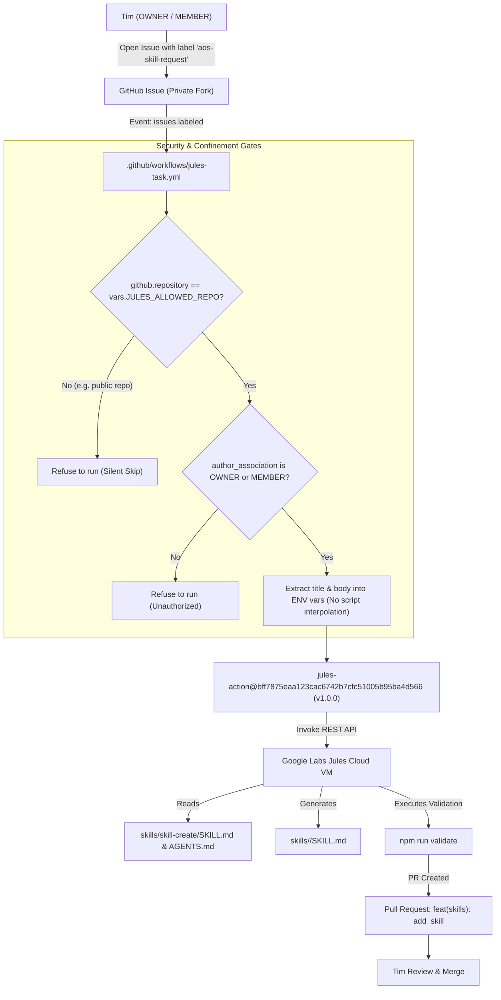

# Google Labs Jules Skill-Implementer Pilot

> **Status:** Hardened Pilot / Inactive by Default (Requires Private Fork Setup)  
> **Target:** Autonomous implementation of BDB Agent OS skills via Google Labs Jules  
> **Harness:** GitHub Actions (`google-labs-code/jules-action`)  
> **Security Tier:** Strict Confinement & Least Privilege  

---

## 1. Overview & Architecture

Maintaining and expanding the AOS skill catalog (over 250 skills) involves deterministic, mechanical steps:
- Creating `skills/<name>/SKILL.md` according to the skill contract in [AGENTS.md](../AGENTS.md).
- Structuring YAML frontmatter (`name`, `description`, `category`).
- Writing guidance, checklists, and references.
- Validating syntax, references, and category enums via `node scripts/validate-skills.mjs`.

**Google Labs Jules** acts as an asynchronous cloud worker running inside an isolated cloud VM. When requested via a GitHub issue, Jules clones the repository, crafts the skill, runs verification, and opens a Pull Request for human review.



---

## 2. Upstream Action Verification

The upstream action [google-labs-code/jules-action](https://github.com/google-labs-code/jules-action) was verified directly from source (`action.yaml`):

- **Action File:** `action.yaml`
- **Pinned Commit SHA:** `bff7875eaa123cac6742b7cfc51005b95ba4d566` (Release tag `v1.0.0` / `ai-assisted`, head of `main`)
- **Inputs Verified:**
  - `prompt` *(required, string)*: Task description and instructions passed to Jules.
  - `jules_api_key` *(required, string)*: API key passed to Jules REST endpoint (`https://jules.googleapis.com/v1alpha/sessions`).
  - `starting_branch` *(optional, string, default `'main'`)*: Base branch for Jules to start from.
  - `include_last_commit` *(optional, boolean, default `false`)*: Whether to include latest git commit diff.
  - `include_commit_log` *(optional, boolean, default `false`)*: Whether to include recent commit history.

The action is pinned by immutable commit SHA:
```yaml
uses: google-labs-code/jules-action@bff7875eaa123cac6742b7cfc51005b95ba4d566 # v1.0.0
```

---

## 3. Setup Steps for Tim (Private Fork Activation)

The workflow is designed to remain completely inert in the public repository `hybridlabor-api/aos`. Follow these steps to activate the pilot in a private fork:

### Step 1: Create a Private Fork / Mirror
1. Create a **Private** repository on GitHub (e.g. `your-org/aos-private` or `timrennings/aos-private`).
2. Push your working branch or mirror `origin/main`.
> [!IMPORTANT]
> Never activate Jules directly on the public `hybridlabor-api/aos` repository. The workflow enforces this via `vars.JULES_ALLOWED_REPO`.

### Step 2: Obtain your Jules API Key
1. Go to the [Google Labs Jules Web App](https://jules.google).
2. Navigate to **Settings** and generate a personal API key.

### Step 3: Configure Repository Secret (`JULES_API_KEY`)
1. In your private repository, go to **Settings → Secrets and variables → Actions → Secrets**.
2. Click **New repository secret**.
3. Name: `JULES_API_KEY`
4. Secret: Paste your API key from Jules.
> [!CAUTION]
> Never commit this key to git, print it in logs, or share it in tickets. Only reference `${{ secrets.JULES_API_KEY }}`.

### Step 4: Configure Repository Variable (`JULES_ALLOWED_REPO`)
1. In your private repository, go to **Settings → Secrets and variables → Actions → Variables**.
2. Click **New repository variable**.
3. Name: `JULES_ALLOWED_REPO`
4. Value: The exact repository path (e.g. `timrennings/aos-private`).
> [!NOTE]
> The workflow evaluates `if: github.repository == vars.JULES_ALLOWED_REPO`. If this variable is unset or does not match, the workflow refuses to run.

### Step 5: Create Issue Label
1. In your private repository, go to **Issues → Labels**.
2. Click **New label**.
3. Name: `aos-skill-request`
4. Color: `#9B30C4` (Orchid)
5. Description: `Triggers Jules Cloud Worker to implement a skill`

---

## 4. Test Issue: `flutter-skill`

To test the end-to-end integration, open an issue in your private repository using the following issue template text:

### Issue Form Fields:
- **Title:** `[Skill]: flutter-skill`
- **Skill Name:** `flutter-skill`
- **Source URL:** `https://github.com/ai-dashboad/flutter-skill`
- **Source License:** `MIT`
- **Attribution:** `ai-dashboad/flutter-skill`
- **Skill Category:** `library`
- **Skill Description & Scope:**
  ```markdown
  Create an AOS skill for Flutter development, focusing on state management, widget testing, and mobile integration.

  Upstream Reference:
  - Repository: https://github.com/ai-dashboad/flutter-skill
  - Upstream Skill File: skills/e2e-testing/SKILL.md
  - License: MIT

  Key Guidelines:
  - Implement skills/flutter-skill/SKILL.md following the AOS skill contract in AGENTS.md.
  - Frontmatter must define name: flutter-skill and category: library.
  - Detail best practices for Flutter testing (WidgetTester, integration_test, mocktail).
  - Include rules for clean widget trees, state separation (Bloc/Riverpod/Provider), and platform channels.
  - Jules must run `npm run validate` and verify 0 errors before submitting the PR.
  ```
- **Implementation Guardrails:** Check all three boxes (Read contract, run validation, Conventional Commits).

---

## 5. Security Architecture & Threat Model

| Threat / Risk | Defense Mechanism |
|---|---|
| **Public Execution / Quota Theft** | Guard `if: github.repository == vars.JULES_ALLOWED_REPO` refuses execution on `hybridlabor-api/aos` or unconfigured forks. |
| **Unauthorized External Triggers** | Access guard `(github.event.issue.author_association == 'OWNER' || github.event.issue.author_association == 'MEMBER')` ensures only repo owners or members can launch cloud jobs. |
| **Script / Command Injection** | Issue title and body are mapped strictly to `env: ISSUE_TITLE` and `env: ISSUE_BODY` and piped via a delimiter block. `${{ github.event.issue... }}` is **never** interpolated inside `run:` blocks. |
| **Action Supply-Chain Attack** | Action pinned to full 40-character commit SHA `bff7875eaa123cac6742b7cfc51005b95ba4d566`. |
| **Credential Exposure** | Least-privilege permissions (`contents: read`, `issues: read`). `JULES_API_KEY` is referenced solely through `${{ secrets.JULES_API_KEY }}`. |
| **Contract Drift** | Jules is instructed to run `npm run validate` (`scripts/validate-skills.mjs`) inside its VM to enforce frontmatter schema and category enums. |

---

## 6. What is NOT Built (Explicit Non-Goals & Backlog)

The following components were analyzed during initial architecture planning ([PLAN.md](../../jules/PLAN.md)) and are deliberately **not** built in this pilot:

1. **`bin/aos-jules` CLI Helper:**
   - A local CLI wrapper that shells out to `gh issue create` or `gh workflow run` is deferred. The pilot operates cleanly through native GitHub Issues and issue forms.
2. **AO 2.0 UI Harness Type:**
   - Exposing Jules as an interactive harness type in the Agent Orchestrator (AO 2.0) UI Orchestration Card alongside `claude-code`, `codex`, and `opencode` is scheduled for Milestone M12.
3. **Automated Merging:**
   - Jules PRs are never merged automatically. They must undergo human review and adhere to the standard release gate.
